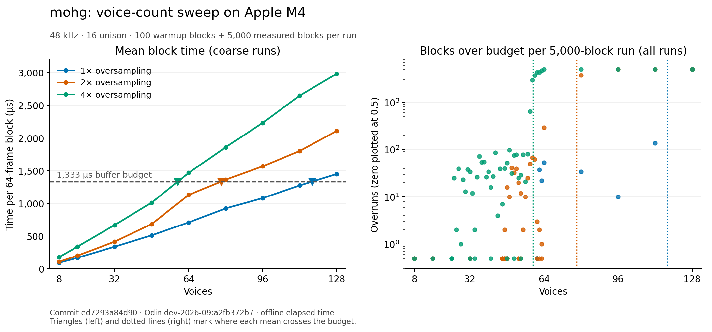

# mohg

A polyphonic synthesizer for macOS written in Odin, with CoreMIDI input and
CoreAudio output.

- Up to 16 detuned oscillators per voice with stereo panning
- Anti-aliased waveforms, per-voice ADSR envelopes, and a nonlinear ladder filter
- Oversampling with FIR decimation, oscillator drift, and stereo chorus
- Lock-free queues for MIDI input and audio-thread telemetry

i built mohg to learn real-time audio and performance engineering. it runs as
a standalone program controlled by a MIDI keyboard, with synth settings in
the source. the performance work focuses on rendering 64 stereo frames at
48 kHz, which gives each block a 1.33 ms time budget.

the full development and profiling writeup is here:
[mohg: Building and profiling a real-time synthesizer](https://athapa.dev/systems/performance/audio/2026/10/22/mohg.html)

## build and play

you'll need macOS, Odin, and Apple's Clang/macOS SDK from Xcode or the Command
Line Tools. i'm using Odin `dev-2026-09` on an Apple MacBook Air with an M4 chip.

connect a MIDI controller, then run from the repo root:

```sh
mkdir -p build
clang -fblocks -O2 -c src/core_midi_bridge.c -o build/core_midi_bridge.o
odin build src -o:speed -out:build/mohg
./build/mohg
```

the synth connects to the first MIDI source it can open and uses the default
audio output. play a note to hear it. press Enter to exit. keep the volume low
while experimenting with resonance and drive.

the settings are in [src/main.odin](src/main.odin). the current defaults are
4 voices, 3 unison oscillators per voice, a saw wave, and 1x oversampling.
edit these settings and rebuild to change the sound.

i'm using an Arturia MiniLab 3. its knobs send CC 74 for filter cutoff,
71 for resonance, and 76 for drive.

## how it works

each voice has its own envelope, oscillators, and left/right filters. the synth
adds the voices together to produce an interleaved stereo buffer. if the user
plays more than `max_voices`, it takes the oldest voice and assigns it the new
note.

the MIDI callback and audio callback run on different threads. i use a
fixed-capacity SPSC queue to pass note and control events to the audio thread,
which applies them between blocks. the voice pool and oscillator arrays are
fixed-size too.

the signal path is:

```text
per voice: oscillators → mix and saturate → left/right ladder filters → envelope
all voices: sum → FIR low-pass filter and downsample → chorus → stereo output
```

with 4x oversampling, the oscillators and filters generate four samples for
each output frame. the FIR decimator filters those samples before keeping
one output, reducing aliasing from the nonlinear processing.

i also added a telemetry queue so i can observe voice events while playing.
the audio thread writes a record, and another thread reads and prints it. if
that queue fills up, it drops the record and counts the drop.

## performance

on an Apple M4, mean render time for **32 voices with 16 unison oscillators
each at 4x oversampling fell from 1.21 ms to 0.67 ms**, a reduction of about
45%. these are offline measurements of the same render function the audio
callback uses.

i used Instruments' hardware performance counters, a fitted cycle-cost model,
and ARM64 disassembly to find where the work went. the main changes were:

- cache per-note oscillator values instead of recalculating them for each sample
- replace `tanh` with a rational approximation
- compute FIR outputs only for the samples retained after downsampling

i also added heavier saturation, drift, and noise between experiments, so
the before/after comparison includes those features. the writeup has the
measurements for each optimization.

### voice-count sweep

with 16 unison oscillators per voice, the mean render time reached the
1.33 ms budget at approximately these voice counts:

| oversampling | first oversampled version | final sweep |
| --- | ---: | ---: |
| 1x | 119 voices | 117 voices |
| 2x | 67 voices | 78 voices |
| 4x | 35 voices | 59 voices |

at 1x, the net result after adding features and optimizing was nearly unchanged. at 4x, the
renderer could handle about 24 more voices before its mean crossed the budget.



these counts measure average throughput, not a guarantee of glitch-free
playback. some offline blocks still exceed the budget in bursts, even when
the average uses only half of it. i'm still investigating those bursts;
the offline benchmark uses different scheduling from the live audio callback.
